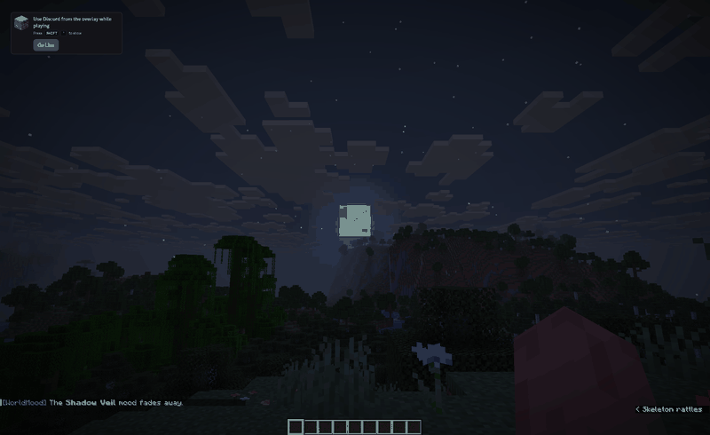

# WorldMood


WorldMood is a Spigot and Paper plugin that runs timed moods on a server. By default it picks one of
seven moods at random every 30 minutes, announces it in chat, shows a boss bar countdown and a short
scoreboard summary, and undoes its changes when the mood ends. It is on
[SpigotMC](https://www.spigotmc.org/resources/137321/) and [Modrinth](https://modrinth.com/plugin/worldmood).



## Moods

The numbers are the defaults from `config.yml`. Every mood can be disabled, weighted or retimed there.

- Blood Moon (night only): hostile mobs get 50% more health, 20% more damage and twice the spawn
  rate. Random events speed mobs up, strike visual lightning or spawn three zombies near each player.
- Calm Skies: natural mob spawning stops in the Overworld, storms clear and players get Regeneration.
- Infernal Heat (day only): players in direct sunlight catch fire unless they wear a helmet. This can
  be changed to full armour, Fire Resistance or no protection. Fire Protection always counts.
- Prosperous Winds: ores have a 15% chance to drop double, mobs have a 10% chance to drop extra
  loot and XP is multiplied by 1.5.
- Lucky Day: five minutes of Luck, villager trades at half price (1.18+), double XP and a small
  chance of treasure items from mining and mob kills.
- Shadow Veil (night only): short bursts of Blindness or Invisibility, ambient sounds and occasional
  Darkness.
- Void Tension: lasts one in-game day. Hostile mobs move faster and teleport, some spawn stronger,
  and random anomalies hit players, such as levitation, nausea and short teleports.

On 1.21 and newer, Blood Moon, Shadow Veil and Void Tension also tint the fog around each player.

## Commands

```
/wm start <mood>   start a mood by its key, e.g. blood_moon
/wm stop           end the current mood
/wm skip           end the current mood and roll a new one
/wm list           show the active mood and all configured moods (also /wm info)
/wm reload         reload config.yml
```

`/wm` is short for `/worldmood`. Every command needs `worldmood.admin`, which ops have by default.

## Installing

There are two jars on the [releases page](https://github.com/Rex-Micky/WorldMood-Plugin/releases).
Use `WorldMood-x.y.z.jar` for 1.20 to 1.21.x (Java 17+) and `WorldMood-x.y.z-legacy.jar` for 1.16.5
to 1.19.x (Java 8+). Install only one of them. On old versions a few visual effects such as Darkness
and the Sonic Boom particle don't exist, so the plugin uses something close and logs what it skipped.

The coloured fog comes from a small datapack that the plugin copies into your main world on first
start. It needs one restart before it works.

Calm Skies turns off the `doMobSpawning` game rule, Blood Moon changes the world border and the fog
moods change biomes around players. WorldMood writes the original values to
`plugins/WorldMood/pending-world-state.yml` before it changes anything, and puts them back on the
next start if the server stopped mid-mood. If you remove the plugin, run `/wm stop` first.

## Building

Run `./gradlew build` with JDK 21. Both jars end up in `build/libs/`.

Bugs go in the [issue tracker](https://github.com/Rex-Micky/WorldMood-Plugin/issues), or ask on
[Discord](https://discord.gg/9bmgP7BpH8). WorldMood is not open source; see [LICENSE](LICENSE).
